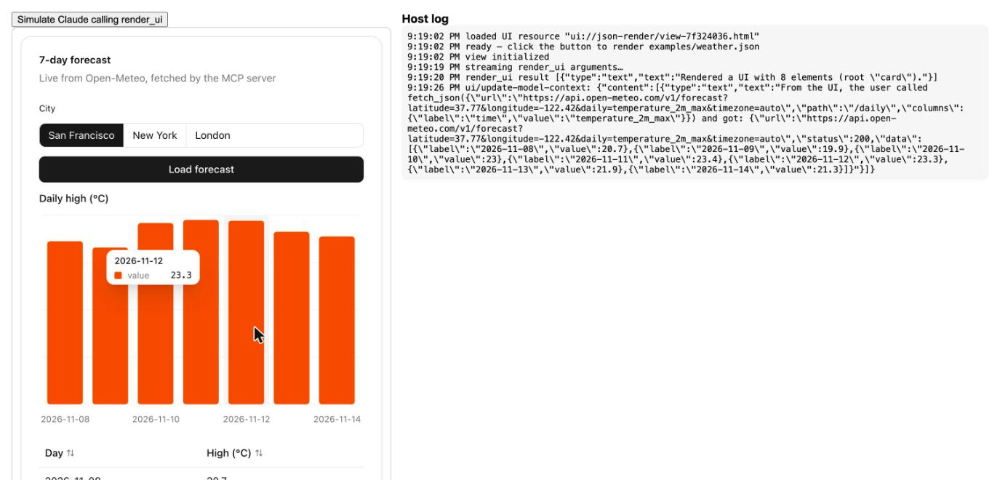
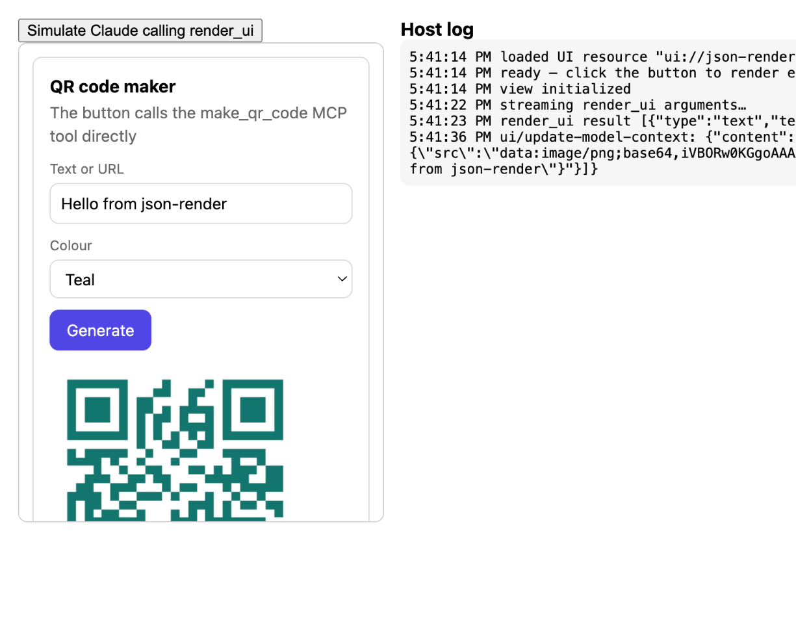

# json-render MCP App

Claude acts as the agent and draws interactive UI with [json-render](https://json-render.dev/), rendered inline by the host through [MCP Apps](https://github.com/modelcontextprotocol/ext-apps).

Claude calls `render_ui` with a json-render spec: a flat map of elements, each restricted to a small component catalog. The host renders that spec in a sandboxed iframe. Buttons call MCP tools on the server directly and never type into the chat. Results flow back into the UI, and Claude sees each call through model context on your next message.


## How the loop works

```
Claude ──render_ui({ spec })──▶ MCP server ──validated spec──▶ UI iframe (json-render)
   ▲                                                              │
   │   ui/update-model-context (after every button call) ◀────────┤
   │                                                              │
   └── list_submissions        submit_form / callTool ◀───────────┘  (tools/call)
```

| Piece | What it does |
| --- | --- |
| `render_ui` | Tool the model sees. Its input schema comes from the catalog: one variant per component with typed props, plus `on` bindings limited to catalog actions. Invalid specs (unknown component, unknown action, dangling child) return an error so Claude can fix and retry. |
| UI resource | One-file React bundle with `@json-render/react`. It renders partial tool input as Claude streams it, then the validated result. |
| `submit` action | Calls the app-only `submit_form` tool directly, with no chat turn, then tells Claude through `ui/update-model-context`. It writes its progress into UI state (`/submitting`, then `/submission = { id, receivedAt }` or `/submissionError`), so the spec can show a confirmation with `visible` conditions. |
| `callTool` action | Calls any tool on this server (`{ name, arguments, resultPath }`). Progress goes to `/calls/<name>/status`, the result to `resultPath` (default `/result`), and a tool that returns `{ spec }` replaces the UI. Nothing is typed into the chat. |
| `setState` / `pushState` | json-render's built-in actions, used to move between screens inside one spec. |
| `list_submissions` | Lets Claude, or a button, read back what the user saved. |
| `make_qr_code` | Demo tool that returns an image: a QR code PNG as MCP image content plus `{ src }` for an Image. `examples/qr-form.json` wires it to a Generate button. |
| `describe_components` | Full docs per component: props as JSON Schema, events, slots and an example. `render_ui`'s description stays a one-line-per-component index and points here. |
| `fetch_json` | GETs a JSON API on the server, because the UI iframe can't reach the network. HTTPS only, limited to an allowlist (default `api.open-meteo.com`, `geocoding-api.open-meteo.com`, `api.github.com`; set `FETCH_ALLOWED_HOSTS` to change it), no redirects, 10 s timeout, 1 MB cap. `path` (a JSON Pointer) trims the response and `columns` zips or renames fields into rows; Tables and charts read arrays of objects directly. `examples/weather.json` loads a live forecast from a button. |


The catalog (`src/catalog.ts`) reuses existing json-render components instead of hand-built ones:

- **[@json-render/shadcn](https://www.npmjs.com/package/@json-render/shadcn):** 34 Radix + Tailwind components (Stack, Grid, Card, Tabs, Dialog, Accordion, Alert, Badge, Input, Select, Switch, Slider, ButtonGroup, Button, Tooltip, Popover, Progress and more). `className` is removed from their props, since Tailwind only ships classes it saw at build time.
- **Metric, Table, BarChart, LineChart, PieChart:** vendored from json-render's [examples/chat](https://github.com/vercel-labs/json-render/tree/main/examples/chat) (Apache-2.0, `src/vendor/`). Recharts with hover tooltips; the Table sorts on header click. All take an array of objects plus field names (`xKey`/`yKey`, `nameKey`/`valueKey`), so `fetch_json` results bind straight in.
- **Svg:** Claude's own drawings (illustrations, icons, diagrams). The server rejects markup with scripts, event handlers, `foreignObject` or external references, and the UI also runs it through DOMPurify. That second layer matters because partial input streams in before the server validates it.

- **Image:** a raster image from a `data:image/...;base64` URL, usually a tool result. External URLs are rejected.



 Inputs bind to state with `{ "$bindState": "/form/name" }`, action params read state with `{ "$state": "/form" }`, and elements can show or hide with `visible` conditions.


## Prompts

The server also publishes two MCP prompts. In Claude Desktop, pick them from the attachment ("+") menu under this server:

| Prompt | Argument | What it does |
| --- | --- | --- |
| `ui` | `request`: anything | Claude answers that request with `render_ui` rather than prose, with buttons for the next steps. |
| `no-textbox` | `topic` (optional) | Claude draws a whole branching flow in one spec. Buttons move between screens with `setState` and add to a breadcrumb with `pushState`, and endings get a Save button. Nothing is typed into the chat. |

`examples/no-textbox.json` shows the first screen. To preview examples in the test host, open `dev/host.html?example=no-textbox` or `?example=dashboard` or `?example=qr-form`.



## Run it

Requires Node 22 or later.

```bash
npm install
npm run build
```

### Claude Desktop (stdio)

Add this to `claude_desktop_config.json` and restart Claude Desktop:

```json
{
  "mcpServers": {
    "json-render": {
      "command": "node",
      "args": ["/absolute/path/to/json-render-mcp-app/dist/main.js", "--stdio"]
    }
  }
}
```

Then try: *"Use render_ui to show me a sign-up form with a name field, a plan picker and a button that asks you to recommend a plan."*

### HTTP

```bash
npm start   # http://localhost:3001/mcp
```

The HTTP server binds to localhost and rejects non-localhost `Host`/`Origin` headers. To reach it from claude.ai you'd need a tunnel and to relax those checks.

### Local test host (no Claude needed)

```bash
npm start      # terminal 1: MCP server on :3001
npm run dev    # terminal 2: opens dev/host.html
```

`dev/host.html` is a minimal MCP Apps host built on `AppBridge`. It loads the UI resource from the server, streams `examples/plan-picker.json` in (pick another with `?example=weather`, `qr-form`, …) as partial tool input, and logs every `ui/message`, `ui/update-model-context` and tool call the UI makes.

## Develop

```bash
npm test         # server tests over an in-memory MCP client
npm run build    # typecheck, UI bundle, server
```

Edit the catalog in `src/catalog.ts` and the matching React components in `src/registry.tsx`. The tool schema, description and `describe_components` output regenerate from the catalog.

## Notes

- `catalog.jsonSchema()` and `catalog.validate()` from json-render leave props untyped and drop `on` bindings, so `src/spec-schema.ts` builds a stricter schema from the same catalog.
- shadcn's Tabs renders every child; panels switch with `value: { "$bindState": "/tab" }` and `visible` conditions (the catalog description says so).
- recharts 2 needs `react-is` 19 under React 19, hence the `overrides` entry in `package.json`; without it bars render empty.
- Hosts cache UI resources by URI, so the resource URI includes a hash of the bundle.
- How partial input streams in, and whether tool calls made from the UI need user confirmation, depends on the host.

## License

MIT
