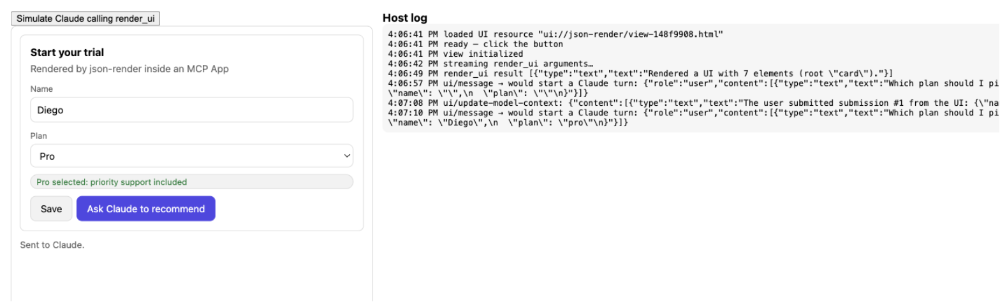
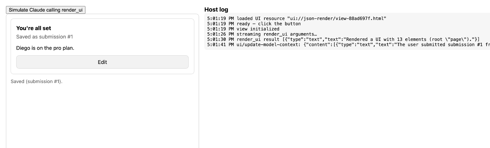

# json-render MCP App

Claude acts as the agent and draws interactive UI with [json-render](https://json-render.dev/), rendered inline by the host through [MCP Apps](https://github.com/modelcontextprotocol/ext-apps).

Claude calls `render_ui` with a json-render spec: a flat map of elements, each restricted to a small component catalog. The host renders that spec in a sandboxed iframe. Buttons in the UI either save data on the server or hand the turn back to Claude, so the UI is part of the agent loop rather than a dead end.



## How the loop works

```
Claude ──render_ui({ spec })──▶ MCP server ──validated spec──▶ UI iframe (json-render)
   ▲                                                              │
   │   ui/message  ("ask" action: a new chat turn)  ◀─────────────┤
   │   ui/update-model-context (after "submit")     ◀─────────────┤
   └── list_submissions                  submit_form ◀────────────┘  (tools/call, app-only)
```

| Piece | What it does |
| --- | --- |
| `render_ui` | Tool the model sees. Its input schema comes from the catalog: one variant per component with typed props, plus `on` bindings limited to catalog actions. Invalid specs (unknown component, unknown action, dangling child) return an error so Claude can fix and retry. |
| UI resource | One-file React bundle with `@json-render/react`. It renders partial tool input as Claude streams it, then the validated result. |
| `submit` action | Calls the app-only `submit_form` tool directly, with no chat turn, then tells Claude through `ui/update-model-context`. It writes its progress into UI state (`/submitting`, then `/submission = { id, receivedAt }` or `/submissionError`), so the spec can show a confirmation with `visible` conditions. |
| `ask` action | Posts a message into the chat as the user (`ui/message`), so Claude reacts and can call `render_ui` again. |
| `list_submissions` | Lets Claude read back what the user saved. |



The catalog (`src/catalog.ts`) currently has Stack, Card, Heading, Text, Badge, TextField, Select and Button. Inputs bind to state with `{ "$bindState": "/form/name" }`, action params read state with `{ "$state": "/form" }`, and elements can show or hide with `visible` conditions.

## Prompts

The server also publishes two MCP prompts. In Claude Desktop, pick them from the attachment ("+") menu under this server:

| Prompt | Argument | What it does |
| --- | --- | --- |
| `ui` | `request`: anything | Claude answers that request with `render_ui` rather than prose, with buttons for the next steps. |
| `no-textbox` | `topic` (optional) | A conversation driven only by buttons. Each choice is an `ask` that hands the turn back, and Claude redraws the next screen with a breadcrumb of your path. Endings get a Save button. |

`examples/no-textbox.json` shows the first screen. To preview it in the test host, open `dev/host.html?example=no-textbox`.

## Run it

Requires Node 22 or later.

```bash
npm install
npm run build
```

### Claude Desktop (stdio)

Add this to `claude_desktop_config.json` and restart Claude Desktop:

```json
{
  "mcpServers": {
    "json-render": {
      "command": "node",
      "args": ["/absolute/path/to/json-render-mcp-app/dist/main.js", "--stdio"]
    }
  }
}
```

Then try: *"Use render_ui to show me a sign-up form with a name field, a plan picker and a button that asks you to recommend a plan."*

### HTTP

```bash
npm start   # http://localhost:3001/mcp
```

The HTTP server binds to localhost and rejects non-localhost `Host`/`Origin` headers. To reach it from claude.ai you'd need a tunnel and to relax those checks.

### Local test host (no Claude needed)

```bash
npm start      # terminal 1: MCP server on :3001
npm run dev    # terminal 2: opens dev/host.html
```

`dev/host.html` is a minimal MCP Apps host built on `AppBridge`. It loads the UI resource from the server, streams `examples/plan-picker.json` in as partial tool input, and logs every `ui/message`, `ui/update-model-context` and tool call the UI makes.

## Develop

```bash
npm test         # server tests over an in-memory MCP client
npm run build    # typecheck, UI bundle, server
```

Edit the catalog in `src/catalog.ts` and the matching React components in `src/registry.tsx`. The tool schema and description regenerate from the catalog.

## Notes

- `catalog.jsonSchema()` and `catalog.validate()` from json-render leave props untyped and drop `on` bindings, so `src/spec-schema.ts` builds a stricter schema from the same catalog.
- Hosts cache UI resources by URI, so the resource URI includes a hash of the bundle.
- How partial input streams in, and whether tool calls made from the UI need user confirmation, depends on the host.

## License

MIT
